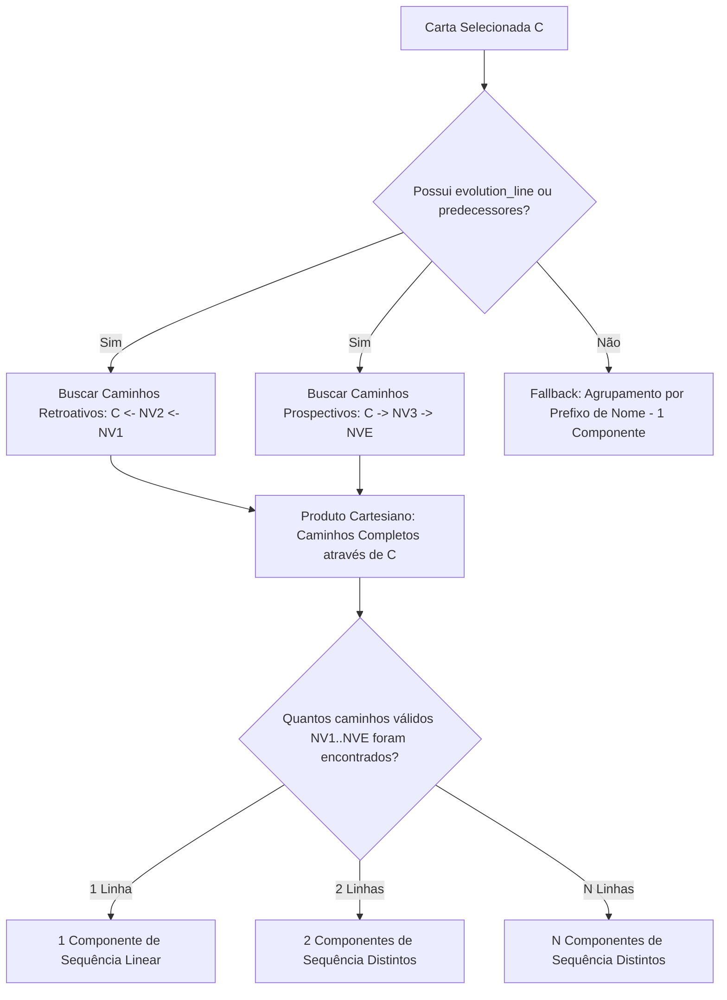

# Especificação Técnica: Inclusão de `evolution_line` no `cards.json` e Aprimoramento da Sequência

**Projeto:** Éther TCG - Card Preview  
**Status:** Atualizado / Complementado pela Spec 10  
**Versão:** 1.1.0  
**Data:** 2026-10-27 (Revisado em 2026-10-28)  
**Arquivos Alvo:**
- [`scripts/clean-cards.mjs`](file:///c:/Users/Hakawa/workspace/ether-preview/scripts/clean-cards.mjs)
- [`src/cards.json`](file:///c:/Users/Hakawa/workspace/ether-preview/src/cards.json)
- [`src/cards.raw.json`](file:///c:/Users/Hakawa/workspace/ether-preview/src/cards.raw.json)
- [`src/types/card.ts`](file:///c:/Users/Hakawa/workspace/ether-preview/src/types/card.ts)
- [`src/lib/sequence.ts`](file:///c:/Users/Hakawa/workspace/ether-preview/src/lib/sequence.ts)
- [`src/components/sequence/CardSequenceViewer.tsx`](file:///c:/Users/Hakawa/workspace/ether-preview/src/components/sequence/CardSequenceViewer.tsx)

---

## 1. Contexto e Problema

No saneamento anterior do dataset [`src/cards.json`](file:///c:/Users/Hakawa/workspace/ether-preview/src/cards.json) (definido na spec `04-cards-json-cleanup-spec.md`), a propriedade `evolution_line` foi descartada por ter sido considerada como metadado redundante.

Entretanto, o componente **Card Sequence Viewer** (`src/components/sequence/CardSequenceViewer.tsx` e `src/lib/sequence.ts`) atualmente agrupa as sequências apenas comparando a primeira palavra antes da vírgula no nome da carta:
```typescript
function extractSequenceKey(name: string): string {
  const beforeComma = name.split(',')[0].trim()
  return normalizeSearchTerm(beforeComma)
}
```

### O Problema Identificado:
1. **Linhagens com nomes diferentes não agrupam**: No Éther TCG, muitas evoluções mudam de nome entre níveis.
   - *Exemplo real no dataset*: 
     - **NV1:** `Goblin Sucateiro` aponta para `evolution_line: "Goblin Engenheiro"`
     - **NV2:** `Goblin Engenheiro` aponta para `evolution_line: "Mograk, Senhor das Forjas"`
     - **NV3:** `Mograk, Senhor das Forjas` aponta para `evolution_line: "Zogath, Senhor das Fortunas"`
     - **NVE:** `Zogath, Senhor das Fortunas`
   - Com o agrupamento por prefixo (`split(',')[0]`), a sequência de `Goblin Sucateiro` nunca encontra `Mograk` nem `Zogath`.
   - Da mesma forma: `Gata das Poesias` (NV1) aponta para `Gata Escultora` (NV2), e `Gata Malabarista` aponta para `Gato dos Truques`. Como `Gata` ≠ `Gato` na extração de prefixo, ocorriam quebras na sequência.
2. **Propriedade ausente no JSON em runtime**: O arquivo [`src/cards.json`](file:///c:/Users/Hakawa/workspace/ether-preview/src/cards.json) e a interface [`CardData`](file:///c:/Users/Hakawa/workspace/ether-preview/src/types/card.ts) não possuem `evolution_line`, impedindo que o front-end descubra a cadeia de evolução.
3. **Propriedade complementar `evolution`**: No dataset bruto ([`src/cards.raw.json`](file:///c:/Users/Hakawa/workspace/ether-preview/src/cards.raw.json)), 303 cartas contêm também a condição de ativação da sequência (ex: `"SEQUÊNCIA: Tenha acumulado 3 Aplausos em qualquer campo."`), que pode enriquecer a UI da galeria de sequência.

---

## 2. Objetivos

1. **Atualizar o script de limpeza [`scripts/clean-cards.mjs`](file:///c:/Users/Hakawa/workspace/ether-preview/scripts/clean-cards.mjs)** para incluir as propriedades `evolution_line` e `evolution` a partir de [`src/cards.raw.json`](file:///c:/Users/Hakawa/workspace/ether-preview/src/cards.raw.json).
2. **Regerar o [`src/cards.json`](file:///c:/Users/Hakawa/workspace/ether-preview/src/cards.json)** mantendo todas as 494 cartas intactas, sem expor dados de auditoria/PII de editores.
3. **Atualizar a interface [`CardData`](file:///c:/Users/Hakawa/workspace/ether-preview/src/types/card.ts)** com os campos `evolution_line?: string` e `evolution?: string`.
4. **Atualizar o utilitário [`src/lib/sequence.ts`](file:///c:/Users/Hakawa/workspace/ether-preview/src/lib/sequence.ts)** para adotar uma estratégia de agrupamento híbrida:
   - **Prioridade 1 (Linhagem por Grafo)**: Se a carta possui `evolution_line` ou é referenciada por outras cartas via `evolution_line`, percorre a árvore direta (sucessores, predecessores e irmãos de mesmo nível).
   - **Prioridade 2 (Prefixo de Nome / Fallback)**: Mantém o agrupamento por prefixo de nome para cartas sem `evolution_line` (ex: `Muskkys`, cartas avulsas).

---

## 3. Schema de Dados Atualizado

### 3.1. Tipagem TypeScript ([`src/types/card.ts`](file:///c:/Users/Hakawa/workspace/ether-preview/src/types/card.ts))

```typescript
export interface CardData {
  id: string
  name: string
  type: string
  number: string
  collection: string
  revisao: string
  description: string
  effect: string
  special: string
  synergy: string
  where_to_find: string
  turns: number | null
  image_url: string
  img_url_webp: string
  thumbnail: string
  level?: string
  rarity?: string

  // Novos campos para Sequência Evolutiva
  evolution_line?: string
  evolution?: string
}

export interface CardsDataset {
  cards: CardData[]
}
```

---

## 4. Atualização do Script de Extração ([`scripts/clean-cards.mjs`](file:///c:/Users/Hakawa/workspace/ether-preview/scripts/clean-cards.mjs))

O script lê de [`src/cards.raw.json`](file:///c:/Users/Hakawa/workspace/ether-preview/src/cards.raw.json) e regrava [`src/cards.json`](file:///c:/Users/Hakawa/workspace/ether-preview/src/cards.json).

```javascript
const allowedFields = [
  'id',
  'name',
  'type',
  'number',
  'collection',
  'revisao',
  'description',
  'effect',
  'special',
  'synergy',
  'where_to_find',
  'turns',
  'image_url',
  'img_url_webp',
  'thumbnail',
  'level',
  'rarity',
  // Sequência e evolução
  'evolution_line',
  'evolution',
]
```

---

## 5. Algoritmo de Resolução de Sequência ([`src/lib/sequence.ts`](file:///c:/Users/Hakawa/workspace/ether-preview/src/lib/sequence.ts))

### 5.1. Resolução Direcionada de Caminhos Evolutivos (DAG)

> [!WARNING] Limitação da Abordagem Anterior de Grafo Conexo Indireto
> A versão 1.0.0 desta especificação propunha unir sucessores, predecessores e irmãos em uma lista única plana (`visited.add`). Isso gerou um bug grave: ramificações paralelas (ex: `Goblin Minerador -> Goblin Fundidor` e `Goblin Sucateiro -> Goblin Engenheiro` convergindo em `Mograk`) e ramificações irmãs de um mesmo ancestral comum (ex: `Zogath`) eram agrupadas todas juntas em uma única fila de 17 cartas, quebrando a regra de que a sequência funciona em níveis lineares progressivos: `NV1 -> NV2 -> NV3 -> NVE`.

A resolução correta modela a linhagem como um Grafo Direcionado Acíclico (DAG) onde cada caminho válido representa uma **linha evolutiva linear independente**:



### 5.2. Regra de Sequência e Ordenação por Nível

A sequência do jogo funciona estritamente nos níveis ordenados:
`NV1` (Nível 1) $\to$ `NV2` (Nível 2) $\to$ `NV3` (Nível 3) $\to$ `NVE` (Nível Épico/Evolução).

```typescript
const LEVEL_ORDER: Record<string, number> = {
  NV1: 1,
  NV2: 2,
  NV3: 3,
  NVE: 4,
}
```

Cada linha evolutiva só conecta cartas com níveis estritamente crescentes. Cartas do mesmo nível **nunca** aparecem sequenciadas com conectores chevrons entre si.

### 5.3. Múltiplas Linhas Evolutivas $\to$ Múltiplos Componentes de Sequência

Quando a carta selecionada faz parte de mais de uma linha evolutiva (por exemplo, `Mograk, Senhor das Forjas` possui 2 linhas evolutivas convergindo nele):
- **Linha 1:** `Goblin Sucateiro [NV1]` $\to$ `Goblin Engenheiro [NV2]` $\to$ `Mograk, Senhor das Forjas [NV3]` $\to$ `Zogath, Senhor das Fortunas [NVE]`
- **Linha 2:** `Goblin Minerador [NV1]` $\to$ `Goblin Fundidor [NV2]` $\to$ `Mograk, Senhor das Forjas [NV3]` $\to$ `Zogath, Senhor das Fortunas [NVE]`

**Regra mandatória de UI/UX:**
Em vez de agrupar tudo em um único componente confuso com 17 cartas, **devem ser criados 2 componentes de sequência independentes** (um para cada linha evolutiva), com a carta selecionada destacada em ambos.

*(Para o detalhamento completo do bug, causa raiz e arquitetura de componentes, consulte a [`docs/specs/10-multi-evolution-lines-spec.md`](file:///c:/Users/Hakawa/workspace/ether-preview/docs/specs/10-multi-evolution-lines-spec.md)).*

---

## 6. Plano de Implementação

| Etapa | Ação | Arquivo |
|---|---|---|
| **1** | Adicionar `evolution_line` e `evolution` ao array `allowedFields` e garantir leitura de `cards.raw.json` | [`scripts/clean-cards.mjs`](file:///c:/Users/Hakawa/workspace/ether-preview/scripts/clean-cards.mjs) |
| **2** | Executar `node scripts/clean-cards.mjs` para regenerar o dataset | [`src/cards.json`](file:///c:/Users/Hakawa/workspace/ether-preview/src/cards.json) |
| **3** | Incluir propriedades opcionais `evolution_line` e `evolution` na interface `CardData` | [`src/types/card.ts`](file:///c:/Users/Hakawa/workspace/ether-preview/src/types/card.ts) |
| **4** | Refatorar `sequence.ts` para resolver caminhos lineares no DAG (`NV1 -> NV2 -> NV3 -> NVE`) em vez de BFS plano | [`src/lib/sequence.ts`](file:///c:/Users/Hakawa/workspace/ether-preview/src/lib/sequence.ts) |
| **5** | Atualizar `CardSequenceViewer.tsx` para renderizar múltiplos componentes quando houver 2 ou mais linhas evolutivas | [`src/components/sequence/CardSequenceViewer.tsx`](file:///c:/Users/Hakawa/workspace/ether-preview/src/components/sequence/CardSequenceViewer.tsx) |
| **6** | Validar casos reais de 2 linhas (`Mograk`, `Gato dos Truques`) e 1 linha (`Goblin Sucateiro`, `Muskkys`) | Testes e preview no navegador |

---

## 7. Critérios de Aceitação (DoD)

- [ ] **CA-01 (Inclusão no JSON)**: `src/cards.json` passa a conter o atributo `evolution_line` para todas as cartas aplicáveis extraídas de `src/cards.raw.json`.
- [ ] **CA-02 (Integridade dos Dados)**: Total de 494 cartas preservadas sem inclusão de PII ou dados irrelevantes de CMS.
- [ ] **CA-03 (Tipagem TypeScript)**: A interface `CardData` inclui `evolution_line?: string` e `evolution?: string`.
- [ ] **CA-04 (Sequência com Nomes Diferentes)**: Cartas com nomes distintos mas pertencentes à mesma linha evolutiva (ex: `Goblin Sucateiro` -> `Goblin Engenheiro` -> `Mograk` -> `Zogath`) aparecem corretamente no `CardSequenceViewer`.
- [ ] **CA-05 (Múltiplas Linhas Evolutivas)**: Se a carta pertencer a 2 linhas evolutivas (ex: `Mograk, Senhor das Forjas`), são renderizados **2 componentes de sequência** dedicados, cada um com sua progressão estrita `NV1 -> NV2 -> NV3 -> NVE`.
- [ ] **CA-06 (Isolamento de Linhagem)**: Cartas de ramos paralelos não selecionados (ex: `Goblin Minerador` ao visualizar `Goblin Sucateiro`) não aparecem na sequência da carta.
- [ ] **CA-07 (Compatibilidade Retroativa)**: Cartas baseadas no prefixo do nome (ex: `Muskkys`) continuam sendo agrupadas sem regressões.
- [ ] **CA-08 (Build / Typecheck)**: Execução de verificação de tipos sem erros no projeto.
