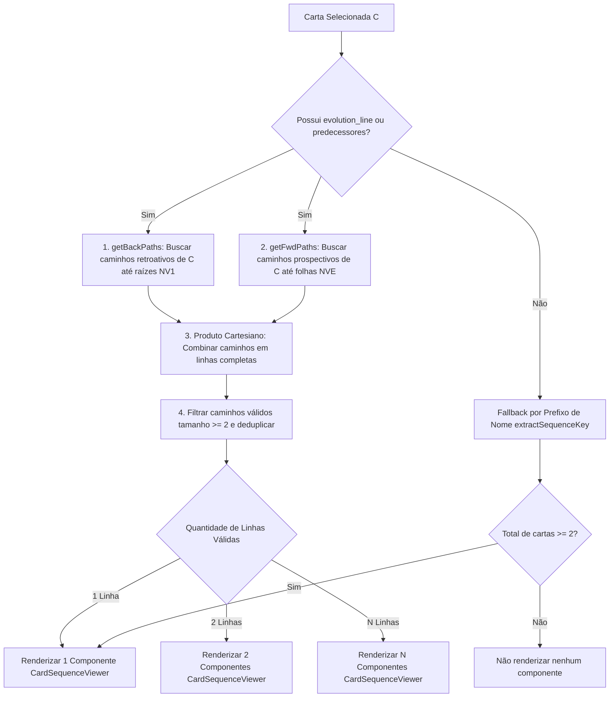

# Especificação Técnica: Resolução de Múltiplas Linhas Evolutivas e Decomposição em Componentes de Sequência

**Projeto:** Éther TCG - Card Preview  
**Status:** Proposto / Pronto para Implementação  
**Versão:** 1.0.0  
**Data:** 2026-10-28  
**Especificação Relacionada:** [`docs/specs/09-cards-evolution-line-spec.md`](file:///c:/Users/Hakawa/workspace/ether-preview/docs/specs/09-cards-evolution-line-spec.md)  
**Arquivos Alvo:**
- [`src/lib/sequence.ts`](file:///c:/Users/Hakawa/workspace/ether-preview/src/lib/sequence.ts)
- [`src/components/sequence/CardSequenceViewer.tsx`](file:///c:/Users/Hakawa/workspace/ether-preview/src/components/sequence/CardSequenceViewer.tsx)
- [`src/components/sequence/SequenceThumbnail.tsx`](file:///c:/Users/Hakawa/workspace/ether-preview/src/components/sequence/SequenceThumbnail.tsx)
- [`src/App.tsx`](file:///c:/Users/Hakawa/workspace/ether-preview/src/App.tsx)

---

## 1. Visão Geral e Motivação

No Éther TCG, a mecânica de **Sequência** representa o ciclo de evolução de um personagem através de níveis canônicos bem definidos:
$$\text{NV1} \longrightarrow \text{NV2} \longrightarrow \text{NV3} \longrightarrow \text{NVE}$$

Durante a validação da Spec 09 ([`09-cards-evolution-line-spec.md`](file:///c:/Users/Hakawa/workspace/ether-preview/docs/specs/09-cards-evolution-line-spec.md)), foi identificado um problema crítico de agrupamento: **cartas que participam de múltiplas linhas evolutivas convergentes tinham todas as suas ramificações colapsadas em uma única lista plana gigantesca**, gerando sequências com até 17 cartas em fila indiana com setas entre cartas do mesmo nível e contadores incorretos como *"Fase 5 de 17"*.

### Regra Central de Negócio:
1. **A sequência funciona estritamente em níveis progressivos:** `NV1` $\to$ `NV2` $\to$ `NV3` $\to$ `NVE`.
2. **Se a carta pertencer a 2 linhas evolutivas, a aplicação deve instanciar 2 componentes de sequência independentes** (e não 1 único componente acumulando tudo).
3. Cada componente de sequência deve exibir apenas a sua respectiva cadeia linear, permitindo ao usuário compreender claramente cada ramificação evolutiva e alternar entre cartas clicando nas miniaturas.

---

## 2. Diagnóstico e Causa Raiz do Bug

### 2.1. Onde está o Bug no Código Atual?

O bug está localizado na função `resolveEvolutionLineage` em [`src/lib/sequence.ts`](file:///c:/Users/Hakawa/workspace/ether-preview/src/lib/sequence.ts#L84-L154):

```typescript
// CÓDIGO COM BUG (src/lib/sequence.ts)
while (queue.length > 0) {
  const current = queue.pop()!
  if (visited.has(current)) continue
  visited.add(current)

  // 1. Adiciona sucessor (para frente)
  if (card.evolution_line) {
    queue.push(normalizeName(card.evolution_line))
  }

  // 2. Adiciona TODOS os predecessores (para trás)
  const preds = predecessorIndex.get(current)
  if (preds) {
    for (const pred of preds) {
      queue.push(normalizeName(pred.name)) // <--- PONTO DE EXPLOSÃO DO GRAFO
    }
  }
}
```

E no agrupamento subsequente em [`src/lib/sequence.ts`](file:///c:/Users/Hakawa/workspace/ether-preview/src/lib/sequence.ts#L208-L217):

```typescript
// CÓDIGO COM BUG: Colapso plano e ordenação cega por nível
const sorted = [...cards].sort((a, b) => levelRank(a.level) - levelRank(b.level))
series.push({ seriesKey: col, label: col, cards: sorted })
```

### 2.2. Por que isso causa o Bug? (As 4 Falhas de Arquitetura)

#### Falha 1: Traversal Não-Direcionado (Explosão de Parentesco / Árvore Genealógica)
O algoritmo tratava a relação de evolução como uma conexão bidirecional irrestrita (BFS não-direcionado). Quando partia de uma carta:
- Ele subia até o ápice da cadeia (ex: `Zogath, Senhor das Fortunas [NVE]`).
- A partir de `Zogath`, a fila visitava **todos os outros NV3s** que também evoluíam para Zogath (`Gruk`, `Krogg`, `Zau`).
- A partir de cada um desses NV3s, a fila visitava todos os seus NV2s e NV1s.
- **Resultado:** Selecionar `Mograk, Senhor das Forjas` ou `Goblin Sucateiro` trazia **17 cartas** de 4 famílias de Goblins diferentes para a mesma esteira!

#### Falha 2: Colapso Linear com Chevrons Conectando Cartas Sem Relação
Ao pegar essas 17 cartas e ordená-las apenas por `levelRank`:
$$\text{NV1} \to \text{NV1} \to \text{NV1} \to \dots \to \text{NV2} \to \text{NV2} \to \dots \to \text{NV3} \to \text{NVE}$$
O componente [`CardSequenceViewer.tsx`](file:///c:/Users/Hakawa/workspace/ether-preview/src/components/sequence/CardSequenceViewer.tsx#L123-L142) renderizava ícones `<ChevronRight />` entre cada índice adjacente do array, criando a falsa impressão visual de que um `Goblin Sucateiro [NV1]` evoluía para um `Goblin Minerador [NV1]`, e este para um `Goblin Explosivo [NV1]`.

#### Falha 3: Suposição de Componente Único (Single-Component UI)
O layout em [`App.tsx`](file:///c:/Users/Hakawa/workspace/ether-preview/src/App.tsx#L94-L100) e [`CardSequenceViewer.tsx`](file:///c:/Users/Hakawa/workspace/ether-preview/src/components/sequence/CardSequenceViewer.tsx) supunha que toda carta só precisava de exatamente **1 container de sequência**. Quando uma carta possui 2 linhas evolutivas legítimas, colocar ambas no mesmo container gera conflito direto com o fluxo linear da esteira de fases.

#### Falha 4: Risco de Ciclos e Auto-referências no Dataset
No arquivo `cards.json`, existem anomalias pontuais como a carta `Vampiro Sicário [NV2]`, que possui `evolution_line: "Vampiro Sicário"`. O algoritmo precisa ter proteção estrita contra auto-referências e ciclos infinitos.

---

## 3. Análise Concreta dos Casos Reais no Dataset

### Caso A: `Mograk, Senhor das Forjas` (NV3) — O Caso das 2 Linhas Evolutivas

No dataset unificado (`src/cards.json`), `Mograk, Senhor das Forjas` possui **2 caminhos distintos** que passam por ele:

```
Linha 1:
[NV1] Goblin Sucateiro ──> [NV2] Goblin Engenheiro ──> [NV3] Mograk, Senhor das Forjas ──> [NVE] Zogath, Senhor das Fortunas

Linha 2:
[NV1] Goblin Minerador ──> [NV2] Goblin Fundidor   ──> [NV3] Mograk, Senhor das Forjas ──> [NVE] Zogath, Senhor das Fortunas
```

- **Comportamento Antigo (Bug):** Renderizava 1 componente único com 17 cartas misturando Gruk, Krogg, Zau e todos os outros goblins.
- **Comportamento Esperado:** Devem ser renderizados **2 componentes de sequência**:
  - **Componente 1:** Exibe a Linha 1 (4 cartas: Sucateiro $\to$ Engenheiro $\to$ Mograk $\to$ Zogath), com Mograk destacado na Fase 3 de 4.
  - **Componente 2:** Exibe a Linha 2 (4 cartas: Minerador $\to$ Fundidor $\to$ Mograk $\to$ Zogath), com Mograk destacado na Fase 3 de 4.

### Caso B: `Goblin Sucateiro` (NV1) — O Caso da Linha Única

Quando o usuário seleciona `Goblin Sucateiro [NV1]`:
- O único caminho prospectivo é: `Goblin Sucateiro [NV1]` $\to$ `Goblin Engenheiro [NV2]` $\to$ `Mograk [NV3]` $\to$ `Zogath [NVE]`.
- Ele **não** passa por `Goblin Minerador` nem `Goblin Fundidor`.
- **Comportamento Esperado:** Renderiza apenas **1 componente de sequência** (4 cartas).

### Caso C: `Gato dos Truques` (NV2) — Convergência de NV1s

`Gato dos Truques [NV2]` possui 2 predecessores NV1 e 1 sucessor NV3:
- **Linha 1:** `Gata Malabarista [NV1]` $\to$ `Gato dos Truques [NV2]` $\to$ `Gato das Máscaras [NV3]`
- **Linha 2:** `Gata Ilusionista [NV1]` $\to$ `Gato dos Truques [NV2]` $\to$ `Gato das Máscaras [NV3]`
- **Comportamento Esperado:** Devem ser renderizados **2 componentes de sequência**, cada um com 3 cartas, e o `Gato dos Truques` destacado na Fase 2 de 3 em ambos.

### Caso D: `Muskkys, Kokedama` (NV1) — Agrupamento por Prefixo de Nome (Fallback)

Cartas sem `evolution_line` estruturado ou com nomes homônimos continuam utilizando o fallback por prefixo de nome, gerando 1 componente de sequência linear ordenado pelos níveis `NV1` $\to$ `NV2` $\to$ `NV3` $\to$ `NVE`.

---

## 4. Arquitetura da Solução e Novo Algoritmo

### 4.1. Modelagem como Grafo Direcionado Acíclico (DAG)

Para cada carta $C$ selecionada no catálogo unificado, definimos uma **Linha Evolutiva Válida** como uma sequência linear de cartas $P = [c_1, c_2, \dots, c_k]$ tal que:
1. $k \ge 2$ (mínimo de duas cartas para constituir sequência).
2. Para todo $i \in [1, k-1]$:
   - $c_i.\text{evolution\_line} \approx c_{i+1}.\text{name}$ (mesmo nome normalizado).
   - $\text{rank}(c_i.\text{level}) < \text{rank}(c_{i+1}.\text{level})$, onde $\text{NV1} < \text{NV2} < \text{NV3} < \text{NVE}$.
3. A carta selecionada $C$ pertence ao caminho: $\exists j \text{ tal que } c_j = C$.

### 4.2. Algoritmo de Resolução Bidirecional por Caminhos



### 4.3. Implementação do Algoritmo em TypeScript ([`src/lib/sequence.ts`](file:///c:/Users/Hakawa/workspace/ether-preview/src/lib/sequence.ts))

```typescript
const LEVEL_RANK: Record<string, number> = {
  NV1: 1,
  NV2: 2,
  NV3: 3,
  NVE: 4,
}

function getLevelRank(level?: string | null): number {
  if (!level) return 0
  return LEVEL_RANK[level.trim().toUpperCase()] ?? 0
}

/**
 * Encontra todos os caminhos lineares independentes (NV1 -> NV2 -> NV3 -> NVE)
 * que passam pela carta selecionada.
 */
export function resolveDirectedEvolutionLines(
  selectedCard: UnifiedCardData,
  allCards: UnifiedCardData[]
): UnifiedCardData[][] {
  const norm = (s: string) => normalizeSearchTerm(s)

  // 1. Mapeamento por nome normalizado
  const byNormName = new Map<string, UnifiedCardData[]>()
  for (const card of allCards) {
    const k = norm(card.name)
    if (!byNormName.has(k)) byNormName.set(k, [])
    byNormName.get(k)!.push(card)
  }

  // 2. Construção de arestas direcionadas válidas com checagem de nível crescente
  const outgoing = new Map<string, UnifiedCardData[]>()
  const incoming = new Map<string, UnifiedCardData[]>()

  for (const card of allCards) {
    outgoing.set(card.id, [])
    incoming.set(card.id, [])
  }

  for (const card of allCards) {
    if (!card.evolution_line) continue
    const targets = byNormName.get(norm(card.evolution_line)) || []
    for (const target of targets) {
      // Protege contra auto-loops (ex: Vampiro Sicário) e exige nível estritamente superior
      const fromRank = getLevelRank(card.level)
      const toRank = getLevelRank(target.level)
      if (target.id !== card.id && (toRank > fromRank || (fromRank === 0 && toRank > 0))) {
        outgoing.get(card.id)!.push(target)
        incoming.get(target.id)!.push(card)
      }
    }
  }

  // 3. Caminhos retroativos até raízes
  function getBackPaths(curr: UnifiedCardData, visited = new Set<string>()): UnifiedCardData[][] {
    if (visited.has(curr.id)) return [[curr]]
    visited.add(curr.id)

    const preds = (incoming.get(curr.id) || []).filter(
      (p) => !visited.has(p.id) && getLevelRank(p.level) < getLevelRank(curr.level)
    )

    if (preds.length === 0) return [[curr]]

    const res: UnifiedCardData[][] = []
    for (const p of preds) {
      const sub = getBackPaths(p, new Set(visited))
      for (const s of sub) {
        res.push([...s, curr])
      }
    }
    return res
  }

  // 4. Caminhos prospectivos até folhas
  function getFwdPaths(curr: UnifiedCardData, visited = new Set<string>()): UnifiedCardData[][] {
    if (visited.has(curr.id)) return [[curr]]
    visited.add(curr.id)

    const succs = (outgoing.get(curr.id) || []).filter(
      (s) => !visited.has(s.id) && getLevelRank(s.level) > getLevelRank(curr.level)
    )

    if (succs.length === 0) return [[curr]]

    const res: UnifiedCardData[][] = []
    for (const s of succs) {
      const sub = getFwdPaths(s, new Set(visited))
      for (const sb of sub) {
        res.push([curr, ...sb])
      }
    }
    return res
  }

  const backPaths = getBackPaths(selectedCard)
  const fwdPaths = getFwdPaths(selectedCard)

  // 5. Produto cartesiano dos caminhos retroativos e prospectivos
  const rawPaths: UnifiedCardData[][] = []
  for (const b of backPaths) {
    for (const f of fwdPaths) {
      const full = [...b.slice(0, -1), ...f]
      if (full.length >= 2) {
        rawPaths.push(full)
      }
    }
  }

  // 6. Deduplicação de caminhos idênticos por lista de IDs
  const uniqueKeyMap = new Map<string, UnifiedCardData[]>()
  for (const path of rawPaths) {
    const key = path.map((c) => c.id).join('->')
    if (!uniqueKeyMap.has(key)) {
      uniqueKeyMap.set(key, path)
    }
  }

  return Array.from(uniqueKeyMap.values())
}
```

---

## 5. Estrutura de Tipos e Modelo de Dados

### 5.1. Novas Interfaces ([`src/types/sequence.ts`](file:///c:/Users/Hakawa/workspace/ether-preview/src/types/sequence.ts) ou [`src/lib/sequence.ts`](file:///c:/Users/Hakawa/workspace/ether-preview/src/lib/sequence.ts))

```typescript
export interface EvolutionLine {
  /** Identificador único da linha (ex: "line-goblin-sucateiro-to-zogath") */
  id: string
  /** Rótulo da linha para exibição visual (ex: "Linha Evolutiva 1", "Linhagem Sucateiro") */
  label: string
  /** Subtítulo descritivo com o ponto de origem (ex: "Origem: Goblin Sucateiro") */
  originDescription?: string
  /** Cartas estritamente ordenadas no fluxo NV1 -> NV2 -> NV3 -> NVE */
  cards: UnifiedCardData[]
  /** Posição (1-based) da carta selecionada nesta linha específica */
  currentPhase: number
  /** Quantidade total de fases da linha */
  totalPhases: number
}

export interface MultiSequenceData {
  /** Linhas evolutivas válidas que passam pela carta selecionada */
  lines: EvolutionLine[]
  /** Booleano indicador se há 2 ou mais linhas evolutivas */
  hasMultipleLines: boolean
  /** Nome de exibição base da seleção */
  displayName: string
}
```

---

## 6. Arquitetura de Componentes e Interface (UI / UX)

### 6.1. Decomposição de Componentes: 2 Linhas $\to$ 2 Componentes de Sequência

Quando `lines.length === 2`:
Em vez de renderizar um container longo ou misturar as cartas, o componente raiz renderiza **dois componentes visuais de sequência**, empilhados verticalmente com espaçamento harmônico (`gap-2.5` a `gap-3`).

#### Visual Mockup (2 Linhas Evolutivas para `Mograk, Senhor das Forjas`):

```
┌─────────────────────────────────────────────────────────────┐
│ ✦ Sequência Evolutiva 1                     Fase 3 de 4     │
│ ┌─────────┐     ┌─────────┐     ┌─────────┐*    ┌─────────┐ │
│ │Sucateiro│ ──> │Engenheir│ ──> │ Mograk  │ ──> │ Zogath  │ │
│ │   NV1   │     │   NV2   │     │   NV3   │*    │   NVE   │ │
│ └─────────┘     └─────────┘     └─────────┘     └─────────┘ │
└─────────────────────────────────────────────────────────────┘

┌─────────────────────────────────────────────────────────────┐
│ ✦ Sequência Evolutiva 2                     Fase 3 de 4     │
│ ┌─────────┐     ┌─────────┐     ┌─────────┐*    ┌─────────┐ │
│ │Minerador│ ──> │Fundidor │ ──> │ Mograk  │ ──> │ Zogath  │ │
│ │   NV1   │     │   NV2   │     │   NV3   │*    │   NVE   │ │
│ └─────────┘     └─────────┘     └─────────┘     └─────────┘ │
└─────────────────────────────────────────────────────────────┘
  * = Carta atualmente selecionada no 3D (destaque com borda e glow primary)
```

### 6.2. Regras de Interatividade e Navegação

1. **Seleção e Destaque:**
   - A carta selecionada (`selectedCard.id`) aparece em estado **selecionado** (`isSelected = true`) em **todos** os componentes de sequência aos quais pertencer.
2. **Clique em Thumbnail:**
   - Clicar em qualquer miniatura de qualquer um dos componentes chama `onSelectCard(card)`.
   - O preview 3D atualiza para a nova carta.
   - O inspetor de detalhes atualiza todas as tags e informações.
   - Os componentes de sequência são recalculados reativamente:
     - Se a carta clicada tiver **1 linha** (ex: clicou em `Goblin Sucateiro`), a interface passa a exibir **1 componente**.
     - Se a carta clicada tiver **2 linhas** (ex: clicou em `Mograk`), a interface exibe **2 componentes**.

---

## 7. Critérios de Aceitação (DoD)

- [ ] **CA-01 (Detecção de Múltiplas Linhas)**: Cartas que possuem 2 linhas evolutivas convergentes ou divergentes (ex: `Mograk, Senhor das Forjas`, `Gato dos Truques`) geram exatamente 2 linhas no resolvedor.
- [ ] **CA-02 (2 Componentes de Sequência na UI)**: Para cartas com 2 linhas evolutivas, a interface renderiza **2 componentes de sequência independentes** com seus respectivos cabeçalhos e esteiras de thumbnails.
- [ ] **CA-03 (Sequência Canônica Estrita)**: Toda esteira de sequência respeita a ordem estrita de fases: `NV1` $\to$ `NV2` $\to$ `NV3` $\to$ `NVE`. Cartas do mesmo nível nunca aparecem conectadas em sequência.
- [ ] **CA-04 (Isolamento de Linhagem)**: Cartas de ramos paralelos não conectados não aparecem na sequência (ex: `Goblin Sucateiro` não exibe `Goblin Minerador` nem ramos primos de `Gruk` ou `Krogg`).
- [ ] **CA-05 (Destaque da Carta Ativa)**: A carta atualmente selecionada no preview 3D é destacada em todas as linhas evolutivas em que estiver presente com borda brilhante e badge "Fase X de Y" correto.
- [ ] **CA-06 (Interatividade Completa)**: Clicar em qualquer thumbnail de qualquer um dos 2 componentes atualiza o preview 3D principal e reavalia a visualização das sequências.
- [ ] **CA-07 (Proteção contra Ciclos e Loops)**: Cartas com auto-referência no dataset (ex: `Vampiro Sicário`) não causam recursão infinita nem quebra da aplicação.
- [ ] **CA-08 (Compatibilidade com Fallback)**: Cartas agrupadas por prefixo de nome (ex: `Muskkys`) continuam sendo exibidas normalmente como 1 componente de sequência.
- [ ] **CA-09 (Build e Sem Erros)**: O código compila sem erros de TypeScript e sem alertas de runtime.
